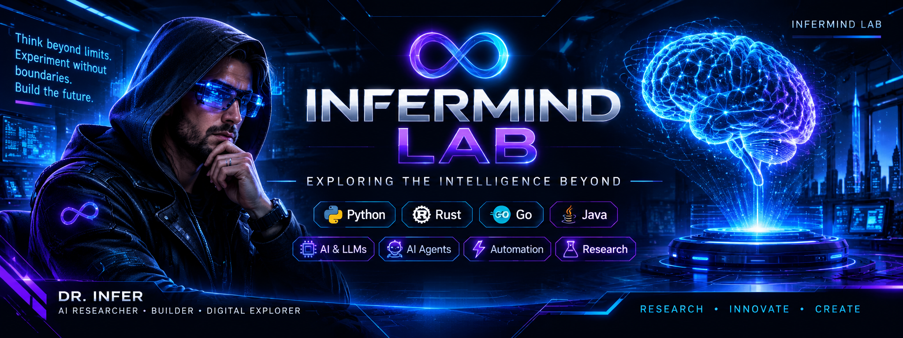

---
# 🧠 INFERMIND LAB

### Exploring the Intelligence Beyond

---

## 👋 Hello, I'm Dr. Infer

**Dorian Drake** — AI Researcher, Builder & Digital Explorer.

Welcome to my digital laboratory.

INFERMIND LAB is an independent creative technology laboratory exploring artificial intelligence, intelligent systems, software engineering and emerging technologies.

My mission is to experiment, build and discover new possibilities at the intersection of human creativity and machine intelligence.

> **Question everything. Generate anything.**

---

## 🔬 Areas of Exploration

- 🤖 Artificial Intelligence & Generative AI
- 🧠 Large Language Models (LLMs)
- ⚡ AI Agents & Autonomous Systems
- 🧪 Prompt Engineering
- 🔗 Intelligent Automation
- 🌐 Human–AI Interaction
- 🔭 Experimental Technologies
- 🛠️ Software & Systems Engineering

---

## 💻 Technology Stack

### Programming Languages

### AI & Machine Intelligence

### Development & Infrastructure

- Git & GitHub
- Linux & Virtual Machines
- APIs & Backend Systems
- Developer Tools
- Automation Workflows

---

## 🚀 Current Mission

Exploring the next generation of intelligent technologies.

Building experimental tools, exploring AI architectures, testing ideas and developing practical solutions.

**Think. Experiment. Build. Evolve.**

---

## 🧬 Laboratory Philosophy

We believe that curiosity is the foundation of innovation.

Technology has no final boundaries. Every experiment is an opportunity to discover something new.

> Think beyond limits.  
> Experiment without boundaries.  
> Build the future.

---

## ⚡ INFERMIND LAB

**DR. INFER**

*Exploring the intelligence beyond.*

---

© INFERMIND LAB
